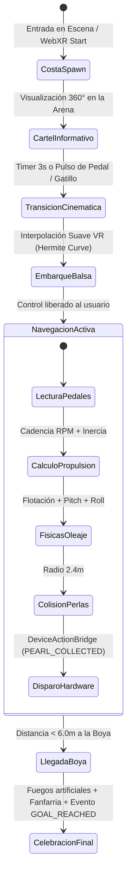

# 🏝️ Kiddo VR — Travesía Costera (WebXR Prototype)

[](https://immersive-web.github.io/webxr/)
[](https://threejs.org/)
[](https://vitejs.dev/)
[](https://www.meta.com/quest/quest-3/)
[](https://developer.mozilla.org/en-US/docs/Web/API/Gamepad_API)
[](https://developer.mozilla.org/en-US/docs/Web/API/Web_Audio_API)

> **Prototipo inmersivo de Realidad Virtual en el navegador (WebXR)** diseñado y optimizado para **Meta Quest 3**, que fusiona actividad física mediante **pedales interactivos**, locomoción náutica sobre una balsa con físicas reactivas de oleaje, gamificación con recolección de perlas y un **puente modular para disparar acciones en dispositivos de hardware externos**.

---

## 📋 Tabla de Contenidos

1. [Visión General del Proyecto](#-visión-general-del-proyecto)
2. [Flujo de la Experiencia (Game Flow)](#-flujo-de-la-experiencia-game-flow)
3. [Características Principales](#-características-principales)
4. [Estructura del Proyecto y Módulos](#-estructura-del-proyecto-y-módulos)
5. [Arquitectura Técnica de Software](#-arquitectura-técnica-de-software)
6. [Sistema de Entrada y Locomoción (Pedales y Fallbacks)](#-sistema-de-entrada-y-locomoción-pedales-y-fallbacks)
7. [Puente con Dispositivos de Hardware Externos](#-puente-con-dispositivos-de-hardware-externos)
8. [Síntesis de Audio Espacial Procedural](#-síntesis-de-audio-espacial-procedural)
9. [Instalación y Despliegue](#-instalación-y-despliegue)
10. [Guía de Acceso en Meta Quest 3](#-guía-de-acceso-en-meta-quest-3)
11. [Telemetría y Depuración](#-telemetría-y-depuración)
12. [Stack Tecnológico](#-stack-tecnológico)

---

## 🎯 Visión General del Proyecto

**Kiddo VR** explora el potencial de la Realidad Virtual combinada con periféricos de ejercicio físico (pedales de rehabilitación / spinning / simuladores) para crear experiencias de estimulación motriz y gamificación de alto impacto.

El usuario inicia la aventura de pie en una playa paradisíaca. Una cinemática suave y libre de cinetosis lo traslada a una balsa de madera flotante en la orilla. Al accionar sus pedales físicos, la balsa navega en el océano hacia una baliza náutica distante (~145 metros), sorteando olas en tiempo real y recogiendo perlas marinas luminosas. Cada logro y métrica de cadencia puede comunicarse en tiempo real a actuadores, microcontroladores o sistemas externos (luces inteligentes, dispensadores, sistemas de monitoreo médico o tableros de control).

```
   [ Playa de Inicio ]
           │
           ▼  (Cinemática VR-Safe)
     [ En la Balsa ]
           │
   ┌───────┴──────────────────────────┐
   │  Pedaleo Físico (Gamepad API)    │
   │  + Timón con Cabeza / Mandos     │
   └───────┬──────────────────────────┘
           ▼
[ Trayecto Marino con Oleaje Dinámico ] ──► (Recolección de 12 Perlas) ──► [ Puente a Dispositivo Externo ]
           │
           ▼  (~145 metros)
  [ Boya Marina / Meta ] ──► Fanfarria + Fuegos Artificiales + Notificación Final
```

---

## 🌊 Flujo de la Experiencia (Game Flow)



1. **Spawn en la Costa:** El usuario aparece posicionado en `(0, 0, 9.5)` sobre la arena cálida de la playa, con un cartel holográfico 3D que explica los controles.
2. **Cinemática de Embarque:** Tras 3 segundos de ambientación o al presionar cualquier pedal/gatillo, se dispara la cinemática de traslado automático que deposita al usuario con suavidad en el asiento de la balsa.
3. **Navegación Interactiva:** La balsa responde a la cadencia física de pedaleo: aceleración, velocidad terminal con resistencia hidrodinámica (`drag`) e inclinación orgánica con las crestas y senos del oleaje.
4. **Recolección de Perlas:** Sendero de 12 perlas nacaradas orbitales con absorción dinámica, partículas de brillo, hápticos y sonido celestial.
5. **Punto de Llegada (Boya Náutica):** Baliza cilíndrica roja/amarilla a 145m con linterna destellante que al ser alcanzada despliega una cascada pirotécnica de partículas y sintetiza una fanfarria triunfal.

---

## ✨ Características Principales

- 🥽 **Experiencia WebXR Nativa para Meta Quest 3:** Espacio de referencia `local-floor` para una correspondencia 1:1 de la altura física de los ojos con el mundo virtual.
- 🚴 **Control por Pedales Analógicos y Digitales:** Integración directa con la **Gamepad API** de navegadores Chromium / Meta Quest Browser para leer pedales USB/Bluetooth genéricos o volantes con pedales (Logitech, Thrustmaster, etc.).
- 🎮 **Múltiples Modos de Respaldo (Fallbacks):**
  - **Meta Quest 3 Touch Controllers:** Locomoción mediante gatillos proporcionales y giros con thumbsticks.
  - **Modo Escritorio / PC:** Controles de órbita 360° (`OrbitControls`) y navegación con teclado (`W`, `A`, `S`, `D`, `Espacio`).
- 🌊 **Océano y Atmósfera Dinámicos:**
  - Shader de agua con reflejos y refracciones mediante Three.js `Water`.
  - Cúpula de cielo dinámico con Three.js `Sky` simulando un sol tropical y dispersión Rayleigh/Mie.
  - Función analítica unificada de oleaje multi-armónico (`getWaveHeight`) compartida entre el shader y las físicas de cabeceo (`pitch`) y balanceo (`roll`) de la balsa.
- 🦪 **Sistema de Perlas Gamificadas:**
  - Material físico iridiscente (`MeshPhysicalMaterial`) con transmisión, brillo y anillo dorado orbital.
  - Detección de colisión volumétrica con la balsa.
  - Efectos visuales de desvanecimiento ascendente y halo estelar de partículas.
- 🔌 **Puente a Dispositivos Externos (`DeviceActionBridge`):**
  - Arquitectura desacoplada y modular mediante interfaz `IDeviceDriver`.
  - 4 Drivers incluidos: **Mock** (logs e interfaz), **WebSocket** (ESP32/Arduino/Raspberry Pi), **Web Bluetooth** (periféricos BLE) y **REST/HTTP** (Webhooks).
- 🔊 **Audio Espacial 100% Procedural:**
  - Síntesis en tiempo real con **Web Audio API** (sin dependencias ni descargas de archivos `.mp3`/`.wav`).
  - Olas rompientes (ruido rosa filtrado), chapoteo reactivo a cada pedaleo, acordes pentatónicos de recolección y fanfarria final.
- 📊 **Dashboard Holográfico en la Balsa:**
  - Pantalla flotante 3D sobre la proa que proyecta perlas recolectadas, cadencia (RPM), velocidad instantánea (km/h), distancia a la boya y estado del enlace externo.

---

## 📁 Estructura del Proyecto y Módulos

El proyecto está organizado en módulos desacoplados bajo principios de alta cohesión y bajo acoplamiento:

```
Kiddo VR/
├── .git/                                # Historial de control de versiones
├── README.md                            # Documentación integral del proyecto
└── vr-prototype/                        # Aplicación WebXR principal
    ├── index.html                       # Shell HTML5, interfaz HUD glassmorphism y botón VR
    ├── package.json                     # Definición del paquete y dependencias (Three.js, Vite)
    ├── vite.config.js                   # Configuración del servidor HTTPS y cabeceras WebXR
    ├── cloudflared.exe                  # Binario local para túnel seguro a Meta Quest 3
    ├── public/                          # Recursos públicos estáticos
    │   ├── favicon.svg
    │   └── icons.svg
    └── src/                             # Código fuente modular JavaScript (ES Modules)
        ├── main.js                      # Punto de entrada, WebGLRenderer y bucle de juego
        ├── style.css                    # Estilos visuales del HUD y telemetría
        │
        ├── scene/                       # Gestión de entornos y mundos 3D
        │   ├── SceneManager.js          # Orquestador maestro de entidades, cámara y eventos
        │   ├── CoastEnvironment.js     # Océano Water, cielo Sky, playa, rocas y palmeras
        │   └── Environment.js          # Entorno cósmico perimetral alternativo
        │
        ├── entities/                    # Entidades interactivas del mundo
        │   ├── Raft.js                  # Balsa: troncos 3D, palas giratorias, física y dashboard
        │   ├── Buoy.js                  # Boya marina: torreta, baliza luminosa y pirotecnia
        │   └── PearlManager.js          # Coleccionables: 12 perlas, colisiones y efectos
        │
        ├── cinematics/                  # Secuencias cinemáticas inmersivas
        │   └── CoastCinematicManager.js # Transición suave de spawn en playa a balsa
        │
        ├── input/                       # Controladores de entrada de usuario
        │   └── PedalController.js       # Captura de pedales físicos vía Gamepad API
        │
        ├── services/                    # Capa de servicios e integración externa
        │   └── DeviceActionBridge.js    # Drivers para comunicación con hardware externo
        │
        ├── audio/                       # Motor de sonido procedural
        │   └── SpatialAudioManager.js   # Generación de oleaje, chapoteo y fanfarrias Web Audio
        │
        ├── vr/                          # Integración con el estándar WebXR
        │   ├── XRSession.js             # Ciclo de vida de la sesión immersive-vr y validación HTTPS
        │   └── XRController.js          # Mapeo de mandos Touch Quest 3 y retroalimentación háptica
        │
        └── utils/                       # Herramientas de utilidad y depuración
            └── debug.js                 # Panel de telemetría en tiempo real
```

---

## 🏛️ Arquitectura Técnica de Software

### Descripción Detallada de Componentes

| Módulo / Archivo | Responsabilidad Principal | Interacciones Clave |
| :--- | :--- | :--- |
| **`main.js`** | Inicializa el `WebGLRenderer`, habilita sombras, SRGB y tone mapping ACESFilmic. Mantiene el bucle `setAnimationLoop` con `Timer`. | Conecta `controllers`, `sceneManager`, `xrSession` y `debug`. |
| **`SceneManager.js`** | Coordina la lógica de juego cuadro a cuadro: lee pedales, actualiza cinemática, balsa, colisiones de perlas, boya y sincronización con el puente externo. | Vincula todas las entidades con el `cameraRig` y el `XRControllerManager`. |
| **`CoastEnvironment.js`** | Construye el entorno costero: sol con `DirectionalLight` y niebla marina `FogExp2`. Provee la función matemática `getWaveHeight(x, z, t)` y `getWaveAngles(x, z, t)`. | Utilizado por `Raft`, `Buoy` y `PearlManager` para flotar con precisión sincronizada. |
| **`Raft.js`** | Construye la geometría 3D de la embarcación (troncos, travesaños, sogas, timón y paletas móviles). Aplica aceleración, inercia e inclinación según el oleaje. Proyecta un dashboard en Canvas 2D. | Recibe potencia de pedaleo de `SceneManager` y porta el `cameraRig`. |
| **`CoastCinematicManager.js`** | Controla el estado del jugador al iniciar (`ON_SHORE` ➔ `TRANSITIONING` ➔ `BOARDED`). Realiza una interpolación cúbica suave para prevenir mareos en VR. | Administra la posición inicial del `cameraRig` y despliega el cartel 3D en la costa. |
| **`PearlManager.js`** | Distribuye 12 perlas a lo largo del eje Z (-12m a -135m). Evalúa proximidad con la balsa y dispara efectos sonoros, hápticos y mensajes hacia el puente de hardware. | Emite llamadas a `DeviceActionBridge.onPearlCollected()` y activa hápticos. |
| **`Buoy.js`** | Punto de llegada a Z=-145m. Contiene un flotador náutico con parachoques, torreta metálica y baliza luminosa intermitente (`PointLight`). Al llegar dispara partículas pirotécnicas. | Retorna condición de victoria a `SceneManager`. |
| **`PedalController.js`** | Detecta gamepads conectados mediante eventos del navegador. Mapea ejes analógicos con zona muerta (`deadzone`) y calcula cadencia instantánea y suavizada en RPM. | Provee métricas de `power` y `cadenceRpm` a `SceneManager`. |
| **`DeviceActionBridge.js`** | Abstracción de comunicación con hardware. Implementa drivers desacoplados para enviar eventos en tiempo real ante recolección de perlas, cadencia y meta. | Conecta el entorno virtual con el mundo físico externo. |
| **`SpatialAudioManager.js`** | Sintetiza en tiempo real todo el paisaje sonoro con Web Audio API: ruido rosa de oleaje marino, salpicadura rítmica de pedales y notas triunfales. | Auto-inicializado con la primera interacción del usuario (`pointerdown` o botón VR). |
| **`XRSession.js`** | Solicita y gestiona la sesión `immersive-vr` con modo `local-floor`. Diagnostica contexto seguro HTTPS y compatibilidad del navegador. | Conecta el DOM (`#btn-enter-vr`) con el `renderer.xr`. |
| **`XRController.js`** | Captura estados analógicos y digitales de los mandos Meta Quest Touch, renderiza mandos estilizados y proporciona disparo de pulsos hápticos (`hapticActuators`). | Informa el estado de mandos a `SceneManager` y `debug.js`. |

---

## 🎮 Sistema de Entrada y Locomoción (Pedales y Fallbacks)

El prototipo está diseñado bajo una filosofía de **accesibilidad universal**, permitiendo la navegación tanto con periféricos de pedaleo dedicados como con los mandos estándar de Quest o teclado de escritorio:

### 1. Pedales Físicos (Gamepad API — Prioridad Primaria)
Detecta dispositivos USB o Bluetooth estándar que reportan como gamepads:
- **Pedales Analógicos:** Ejes `axes[1]` (pedal izquierdo) y `axes[3]` / `axes[2]` (pedal derecho). Los valores se normalizan de `[-1, 1]` a `[0, 1]` con una zona muerta de seguridad del 5% (`0.05`) para evitar drift.
- **Pedales Digitales (Switches):** Lectura directa de `buttons[0]` y `buttons[1]`.
- **Cálculo de Cadencia:** Registra la frecuencia de alternancia entre pedales izquierdo y derecho para estimar RPM (revoluciones por minuto) reales. Cada brazada detectada emite un sonido de chapoteo en el agua.

### 2. Mandos Touch de Meta Quest 3 (Fallback Inmersivo)
- **Acelerador Proporcional:** Mantener presionado el **Gatillo Derecho o Izquierdo** acelera la balsa con potencia proporcional a la presión (simula cadencia de 0 a 70 RPM).
- **Stick Izquierdo (Eje Y):** Empujar hacia adelante para avanzar manualmente.
- **Stick Derecho / Izquierdo (Eje X):** Permite timonear y corregir el rumbo de la balsa a estribor o babor.
- **Vibración Háptica:** Pulso de intensidad 0.65 (140 ms) al recolectar perlas; pulso de intensidad máxima 1.0 (450 ms) al llegar a la boya.

### 3. Modo Teclado y Ratón (Modo Escritorio / PC)
- `W` o `Barra Espaciadora`: Propulsión continua a potencia de crucero (~65 RPM).
- `A` / `D` o `Flechas`: Timonear hacia la izquierda o derecha.
- `Arrastrar Ratón`: Control de órbita 360° para inspeccionar el mapa libremente.

---

## 🔌 Puente con Dispositivos de Hardware Externos

El sistema incluye una interfaz desacoplada en `src/services/DeviceActionBridge.js` que permite ejecutar acciones físicas en dispositivos externos sin modificar el núcleo del juego.

```
       ┌────────────────────────┐
       │     PearlManager       │ ──► onPearlCollected({ id, total, target })
       │      SceneManager      │ ──► onCadenceUpdate({ rpm, speedKmh })
       │        Buoy.js         │ ──► onGoalReached({ totalTime, totalPearls })
       └───────────┬────────────┘
                   │
                   ▼
       ┌────────────────────────┐
       │   DeviceActionBridge   │
       └───────────┬────────────┘
                   │
      ┌────────────┼────────────┬─────────────┐
      ▼            ▼            ▼             ▼
 [MockDriver] [WebSocket]  [Bluetooth]   [REST/HTTP]
   (DOM/UI)    (ESP32 /     (BLE Smart     (Webhooks /
               Arduino)      Devices)       Cloud API)
```

### Eventos Emitidos

#### 1. Recolección de Perla (`PEARL_COLLECTED`)
Disparado en el instante exacto en que la balsa colisiona con una perla:
```json
{
  "event": "PEARL_COLLECTED",
  "pearlId": 3,
  "totalCollected": 4,
  "targetTotal": 12,
  "position": { "x": 1.25, "y": 0.45, "z": -42.8 },
  "timestamp": 1729124400123
}
```

#### 2. Actualización de Cadencia (`CADENCE_UPDATE`)
Disparado periódicamente cada 1 segundo con la telemetría de pedaleo:
```json
{
  "event": "CADENCE_UPDATE",
  "rpm": 68,
  "speedKmh": 14.2,
  "timestamp": 1729124401123
}
```

#### 3. Llegada a la Meta (`GOAL_REACHED`)
Disparado al alcanzar el radio de proximidad de la boya marina:
```json
{
  "event": "GOAL_REACHED",
  "totalTimeSec": 74,
  "totalPearls": 12,
  "distanceMeters": 145,
  "timestamp": 1729124474123
}
```

### Cómo Conectar tu Propio Hardware (Ejemplo ESP32 / WebSocket)
Para conectar un microcontrolador que encienda un LED, active un dispensador o active vibración externa:

```javascript
import { WebSocketDeviceDriver } from './services/DeviceActionBridge.js';

// En SceneManager.js o main.js:
const esp32Driver = new WebSocketDeviceDriver('ws://192.168.1.120:81');
sceneManager.deviceBridge.setDriver(esp32Driver);
```

---

## 🔊 Síntesis de Audio Espacial Procedural

Toda la atmósfera auditiva se genera mediante la **Web Audio API** de forma puramente matemática y sintética:

1. **Océano y Rompiente de Olas:** Generador continuo de ruido rosa filtrado con moduladores periódicos LFO que simulan el flujo y reflujo de las olas contra la orilla y la balsa.
2. **Chapoteo del Pedaleo:** Sonido percusivo de agua que modula su volumen y tono de acuerdo a la potencia real ejercida en el pedaleo.
3. **Tintineo de Perlas:** Síntesis FM y osciladores sinusoidales en frecuencias de campana pentatónica mayor con envolventes de decaimiento largo.
4. **Fanfarria Triunfal:** Arpegio de acordes mayores con brillo metálico que celebra la consecución del objetivo en la boya.

*Ventaja técnica: Carga instantánea, cero peticiones de red para archivos multimedia y sincronización perfecta con los cuadros del render.*

---

## 🚀 Instalación y Despliegue

### Requisitos Previos
- **Node.js**: Versión 18.0.0 o superior recomendada.
- **NPM**: Incluido con Node.js.
- **Navegador**: Google Chrome, Edge o Meta Quest Browser con soporte WebXR.

### Pasos de Instalación

1. **Clonar el repositorio:**
   ```bash
   git clone https://github.com/angellvsdev/kiddo-vr-prototype.git
   cd kiddo-vr-prototype/vr-prototype
   ```

2. **Instalar dependencias:**
   ```bash
   npm install
   ```

3. **Iniciar el servidor de desarrollo seguro (HTTPS):**
   ```bash
   npm run dev
   ```
   *Nota: Vite utiliza `@vitejs/plugin-basic-ssl` para generar un certificado HTTPS autofirmado de inmediato, requisito obligatorio de la especificación WebXR.*

---

## 🥽 Guía de Acceso en Meta Quest 3

Para ejecutar el prototipo de forma inalámbrica dentro de tus gafas Meta Quest 3 dispones de dos alternativas:

### Opción A: A través de Red Local (Misma red WiFi)
1. Conecta tu computadora y el Meta Quest 3 a la misma red WiFi (preferentemente 5 GHz o WiFi 6).
2. Obtén la IP local de tu ordenador (ej. `192.168.1.45`).
3. Abre la app **Navegador (Meta Quest Browser)** en el visor.
4. Ingresa a la URL: `https://192.168.1.45:5173`
5. Si el navegador advierte sobre el certificado SSL autofirmado, haz clic en **Avanzado ➔ Continuar al sitio**.
6. En la pantalla inicial, pulsa el botón flotante **🥽 ENTRAR A VR INMERSIVO (QUEST 3)**.

### Opción B: A través de Túnel Seguro Cloudflare (Sin restricciones de red)
El proyecto incluye `cloudflared.exe` para exponer el servidor de desarrollo a Internet con un certificado SSL válido global:
```bash
./cloudflared.exe tunnel --url https://localhost:5173
```
Copia la URL pública generada (ej. `https://xxx-xxx.trycloudflare.com`) e ingrésala en el Meta Quest Browser.

---

## 📊 Telemetría y Depuración

En la esquina inferior derecha de la pantalla se encuentra el botón **🎮 Telemetría**, el cual despliega un panel en tiempo real con:
- Estado y nombre del periférico de pedales conectado.
- Cadencia instantánea en RPM y brazadas detectadas.
- Conteo de perlas (`x / 12`).
- Última acción y timestamp enviados al dispositivo externo.
- Desplazamiento y posición analógica de los sticks y gatillos de los mandos Quest 3.
- Cantidad de controladores WebXR vinculados activamente.

---

## 🛠️ Stack Tecnológico

- **Gráficos 3D & Motor WebXR:** [Three.js](https://threejs.org/) (r186+)
- **Librerías Adicionales Three.js:** `Sky.js`, `Water.js`, `OrbitControls.js`
- **Entorno de Ejecución & Empaquetador:** [Vite](https://vitejs.dev/) + `@vitejs/plugin-basic-ssl`
- **APIs Web Estándar:**
  - [WebXR Device API](https://developer.mozilla.org/en-US/docs/Web/API/WebXR_Device_API) (`immersive-vr`)
  - [Gamepad API](https://developer.mozilla.org/en-US/docs/Web/API/Gamepad_API) (Lectura continua de periféricos)
  - [Web Audio API](https://developer.mozilla.org/en-US/docs/Web/API/Web_Audio_API) (Audio espacial y procedural)
  - [Canvas API](https://developer.mozilla.org/en-US/docs/Web/API/Canvas_API) (Texturas dinámicas de interfaces 3D)
- **Túnel y Testing Remoto:** Cloudflare Tunnel (`cloudflared`)

---

## 📄 Licencia

Este proyecto está bajo la licencia MIT. Eres libre de adaptarlo, extenderlo y utilizarlo para prototipos comerciales o académicos.
